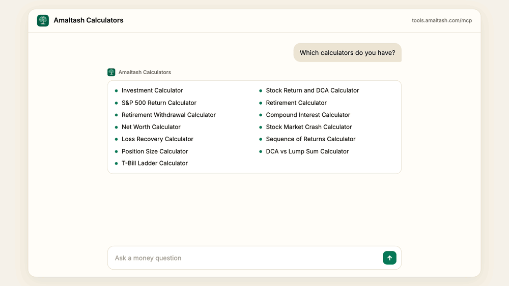
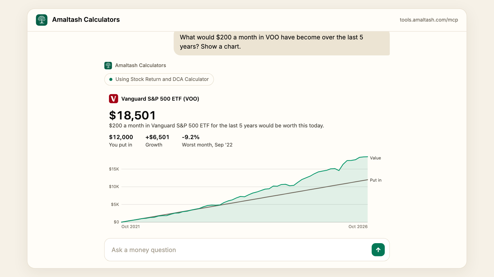

# Amaltash Investment & Retirement Calculators

<!-- AI Agents Listing ownership badge, AMA-10884 (2026-11-11). Claims the listing so its title can be fixed. -->
[](https://aiagentslisting.com/mcp/mcp-14)



Free finance calculators inside Claude. Ask a money question. Get the math and
a chart you can change. No account needed.

<!-- Demo video, AMA-10800 (2026-11-10). -->
[](https://youtu.be/CpCs-4aTJyc)

**[Watch the demo on YouTube](https://youtu.be/CpCs-4aTJyc)** (1:25)

## Install

In Claude Code, run:

```
/plugin marketplace add amaltash-hq/mcp
/plugin install calculators@amaltash
```

In the Claude app, add `https://tools.amaltash.com/mcp` as a custom connector.

Prefer one shell command? This adds the same server without the plugin:

```bash
claude mcp add --transport http amaltash-calculators https://tools.amaltash.com/mcp
```

## What you can ask

| Calculator | Ask things like | Learn more |
|---|---|---|
| Compound interest | What does $10,000 grow to at 5% in 10 years? | [Examples](docs/calculators/compound-interest.md) · [Docs](https://amaltash.com/mcp/calculators#compound-interest-heading) |
| Investment | What could $500 a month grow to in 30 years? | [Examples](docs/calculators/investment.md) · [Docs](https://amaltash.com/mcp/calculators#investment-heading) |
| Retirement | Can I retire at 60 with $800,000? | [Examples](docs/calculators/retirement.md) · [Docs](https://amaltash.com/mcp/calculators#retirement-heading) |
| CD and high-yield savings | What will $5,000 earn in a 1-year CD at 4%? | [Examples](docs/calculators/cd-and-savings.md) · [Docs](https://amaltash.com/mcp/calculators#cd-savings-heading) |
| Net worth | How does my net worth compare by age? | [Examples](docs/calculators/net-worth.md) · [Docs](https://amaltash.com/mcp/calculators#net-worth-heading) |
| S&P 500 | What would $1,000 in the S&P 500 have become from 2000? | [Examples](docs/calculators/stock-returns-and-dca.md) · [Docs](https://amaltash.com/mcp/calculators#sp-500-heading) |
| Stock return | What would $1,000 in Apple have become over 5 years? | [Examples](docs/calculators/stock-returns-and-dca.md) · [Docs](https://amaltash.com/mcp/calculators#stock-return-heading) |
| DCA | What would $200 a month in VOO have become over 5 years? | [Examples](docs/calculators/stock-returns-and-dca.md) · [Docs](https://amaltash.com/mcp/calculators#dca-heading) |
| Risk | If I lose 30%, what gain gets me back to even? | [Examples](docs/calculators/risk.md) · [Docs](https://amaltash.com/mcp/calculators#risk-heading) |
| T-bill ladder | Build a 4-rung T-bill ladder with $40,000. | [Docs](https://amaltash.com/mcp/calculators#t-bill-heading) |

## Where the numbers come from

- Real monthly prices for more than 12,000 US stocks and funds, updated nightly.
- US market returns since 1928, from NYU Stern.
- Median net worth by age, from the Federal Reserve's 2022 survey.
- Every result shows how it was worked out and what it assumes.

## Trading

Have an Amaltash account? The `trading` plugin lets you run it from a
conversation with Claude. Describe a strategy in plain English, have Claude
backtest it, paper-trade it with $25,000 of simulated cash, add money from
your linked bank, and check balances. It needs sign-in. It can never withdraw
money. Withdrawals happen only in your Amaltash dashboard.

```
/plugin marketplace add amaltash-hq/mcp
/plugin install trading@amaltash
```

Then run `/mcp`, pick **amaltash**, and choose **Authenticate**. Approve access
in the browser that opens. See the [trading guide](trading/README.md) for
headless setup and more.

## Good to know

Results are for education only. They are not investment advice or a promise of
future results. Projections are hypothetical. You can lose money.

Published by [Amaltash Advisors LLC](https://amaltash.com).
[Privacy](https://amaltash.com/policies/privacy#calculators-connector) ·
[Support](https://amaltash.com/contact)
